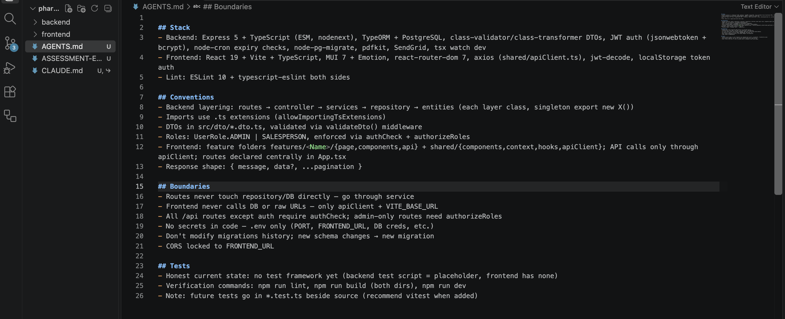
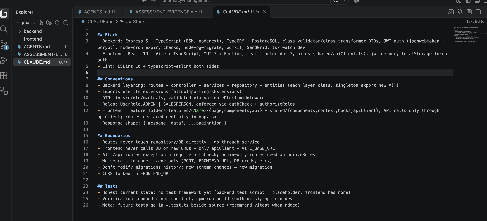
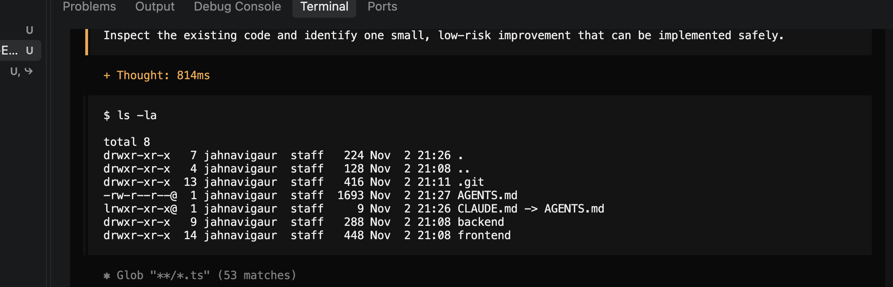
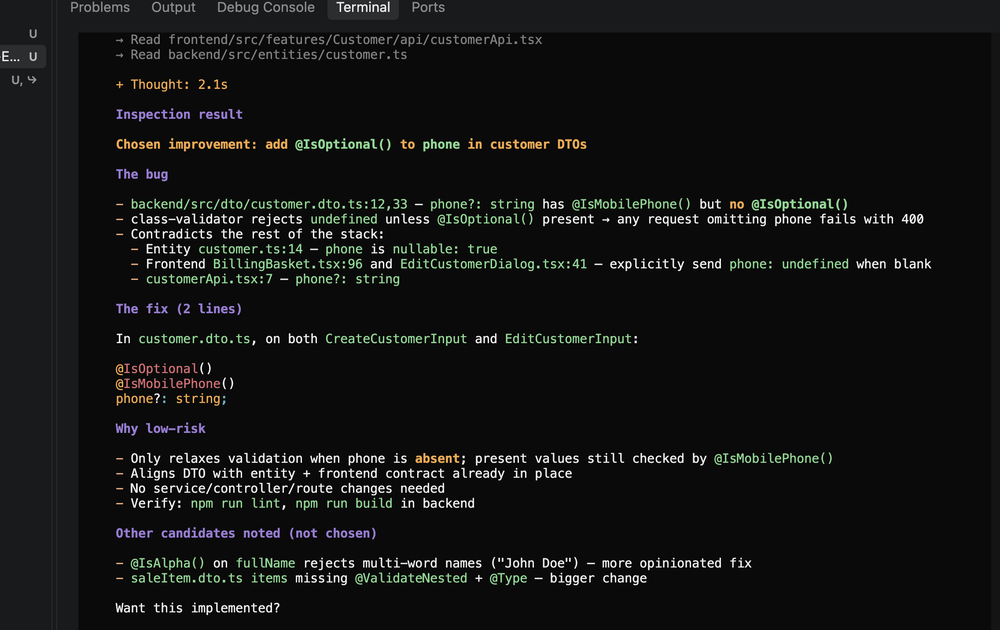

# Repository Context Assessment – Evidence Record

## 1. Repository Details

- Repository: pharmacy-management
- Date: 2 November 2026

## 2. Standard Instruction File

- File created: `AGENTS.md`
- Location: Repository root
- Sections included:
  - Stack
  - Conventions
  - Boundaries
  - Tests

## 3. Dialect Translation

- Original file: `AGENTS.md`
- Translated file: `CLAUDE.md`
- Chosen dialect: Claude Code
- Reason: To make the same repository-specific instructions available to Claude Code.

## 4. Real Task Demonstration

- Tool used: OpenCode
- Model used: Mimo-V2.6-Flash (free model from opencode)
- Date: 2 November 2026

**Task performed:**

Asked OpenCode to inspect the existing codebase and identify one small, low-risk improvement that could be implemented safely.
OpenCode inspected the backend DTOs, validation middleware, customer entity, services and related frontend API files to understand the existing implementation.
It identified a potential validation issue in backend/src/dto/customer.dto.ts, where the optional phone field in both CreateCustomerInput and EditCustomerInput had @IsMobilePhone() but was missing @IsOptional().
OpenCode proposed adding @IsOptional() to both fields. This would allow requests without a phone number while continuing to validate phone numbers when provided.

**Instructions applied:**

OpenCode followed these repository-specific conventions from AGENTS.md:

- Backend DTO Convention: The instructions specify that DTOs must be maintained inside src/dto/*.dto.ts and validated using the existing validation middleware. OpenCode inspected the existing DTO files and validation middleware before suggesting a change.
- Existing Architecture: The instructions define the existing backend architecture and layering. OpenCode inspected the customer entity, services and frontend API usage to understand the existing implementation before proposing a change.
- Low-risk Changes: The instructions establish boundaries around modifying existing application functionality. OpenCode proposed a limited two-line DTO validation change without suggesting unnecessary service, controller or route modifications.
- Testing Convention: The instructions specify npm run lint and npm run build as verification commands. OpenCode recommended these commands for verifying the proposed backend change.
- Evidence: OpenCode inspected customer.dto.ts, validation.middleware.ts, customer.ts and related frontend files before identifying the improvement.
- Note: The proposed fix and its test results have not yet been verified because no source-code changes were made.

**Observed result:**

- OpenCode successfully inspected the existing repository structure and relevant source files before identifying a potential validation issue in the customer DTOs.
- It compared the DTO validation rules with the customer entity and frontend implementation, identified an inconsistency in how optional phone numbers were handled, and proposed a minimal two-line improvement.
- It also explained why the change was considered low-risk, identified alternative improvement candidates, and recommended the appropriate backend verification commands (npm run lint and npm run build).
- OpenCode did not modify any source files or implement the proposed fix. The task was limited to repository inspection and improvement identification.
- This demonstrated how repository-level instructions helped guide the AI agent's understanding of the existing architecture, coding conventions and verification process.

## 5. Evidence Attachments

1. Screenshot of the completed `AGENTS.md`- 
2. Screenshot of the `CLAUDE.md` translation -  
3. Screenshot of the OpenCode task and its response -  and 

## 6. Conclusion

- Created a repository-level instruction standard using AGENTS.md, covering the project's technology stack, coding conventions, boundaries and testing practices.
- Translated the instructions into a Claude Code dialect using CLAUDE.md.
- Performed a real repository inspection task using OpenCode with the Mimo-V2.6-Flash model. The agent identified a potential validation issue and proposed a low-risk improvement consistent with the repository's existing architecture and conventions.
- The exercise demonstrated the practical use of repository context instructions in guiding AI coding agents during software development.