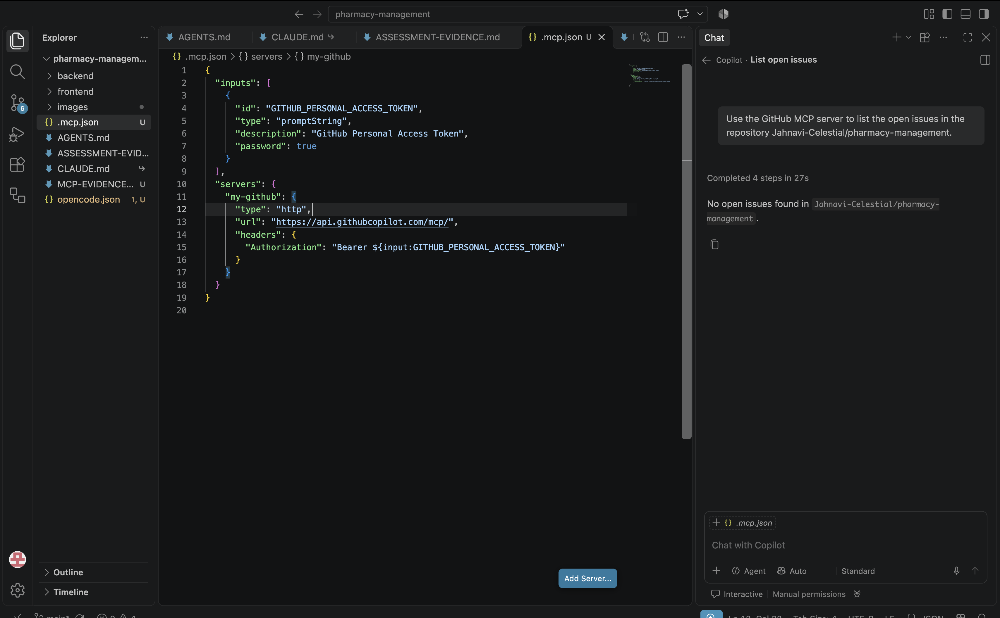

# Two-Tool MCP Reuse Exercise — Evidence

**Completion date:** 3 November 2026  
**MCP server:** GitHub MCP  
**Server endpoint:** `https://api.githubcopilot.com/mcp/`  
**Repository tested:** `Jahnavi-Celestial/pharmacy-management`

## 1. Tool A — OpenCode

- MCP server configured: Yes
- Connection successful: Yes
- Action performed: Listed open GitHub issues
- Result: Successful
- Evidence: 

## 2. Tool B — VS Code + GitHub Copilot

- Reused server endpoint and authentication configuration: Yes
- Connection successful: Yes
- Action performed: Listed open GitHub issues
- Result: Successful
- Evidence: 

## 3. MCP Configuration Reuse

The same GitHub MCP server endpoint, authentication method, and repository permissions were reused in both tools.

The configuration syntax was adapted to each tool's supported format. The GitHub MCP server itself was not rebuilt.

## 4. Outcome

Both tools were tested using the same GitHub MCP server and the same repository. The successful MCP actions and configuration evidence are attached.
